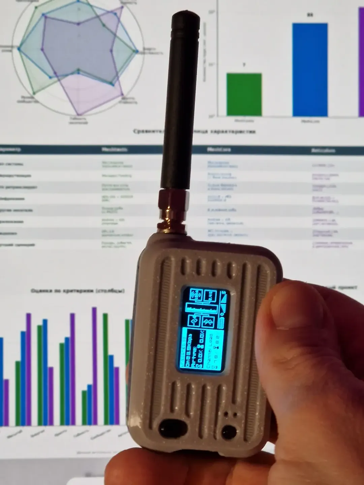
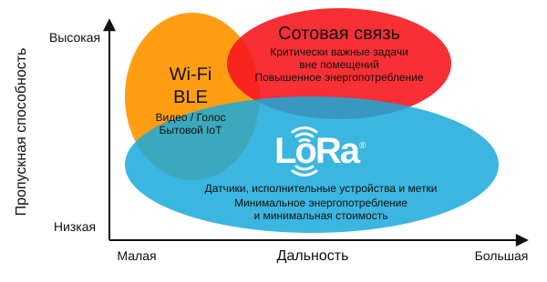
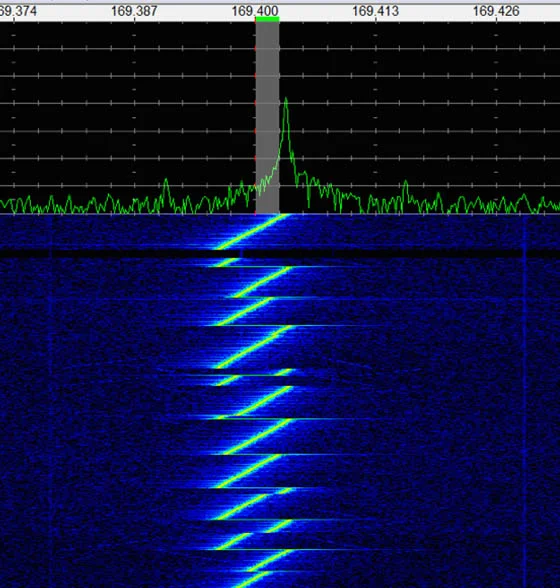

# Что такое RNode

**RNode** — это компактный радиоинтерфейс, позволяющий Reticulum передавать данные через LoRa-радиоканал.

RNode — открытая платформа, на основе которой разные производители и сами пользователи могут создавать совместимые
радиоустройства. Можно купить готовый RNode, установить **RNode Firmware** на поддерживаемую плату с радиомодулем
или собрать собственное устройство. Прошивка RNode Firmware управляет оборудованием и обеспечивает связь с программами
на подключённом компьютере или смартфоне.

Пример платы с прошивкой RNode ([источник](https://www.instagram.com/p/DejzxiQoUVh/)):


Проще всего представить его как радиомодем:

```text
Reticulum
    │
    │ USB / Serial
    ▼
  RNode
    │
    │ LoRa
    ▼
  Антенна
```

RNode принимает от Reticulum готовые данные, передаёт их по радио и возвращает принятые из эфира пакеты обратно в Reticulum.

## Как здесь используется LoRa

**LoRa** — способ модуляции радиосигнала, позволяющий передавать данные на большие расстояния при небольшой скорости.
В этой статье рассматриваются RNode с LoRa-радиомодулями.



RNode использует LoRa напрямую, без протокола **LoRaWAN**, который часто применяется в сетях датчиков.
Для связи между RNode не нужны шлюз и сетевой сервер LoRaWAN. Адресацию, сквозное шифрование и маршрутизацию
в описанной здесь сети обеспечивает Reticulum.

LoRa модуляция на радио-спектре ([источник](https://www.link-labs.com/blog/what-is-lora)):


## Что находится внутри

Типичный RNode состоит из:

```text
┌───────────────────────────────┐
│             RNode             │
│                               │
│   MCU ───────── LoRa-чип ── RF│
│    │                          │
└────┼──────────────────────────┘
     │
     USB / Serial
     │
     ▼
  компьютер
```

Микроконтроллер управляет радиочипом и реализует протокол связи с Reticulum.

В качестве радиочасти обычно используются LoRa-трансиверы семейства **Semtech SX127x или SX126x**.

Сам Reticulum при этом работает на компьютере, Raspberry Pi, смартфоне или другом устройстве, к которому подключён RNode.

## Простейший радиолинк

Простейшая схема радиосвязи — два компьютера с Reticulum и два RNode с подходящими антеннами:

```text
Компьютер A                                     Компьютер B
    │                                               │
   USB                                             USB
    │                                               │
 RNode A  ))))))))))))      LoRa      (((((((((( RNode B
```

Оба RNode должны использовать совместимые параметры радио:

- частоту — **Frequency**;
- полосу сигнала — **Bandwidth**;
- коэффициент расширения спектра — **Spreading Factor**;
- параметр избыточного кодирования — **Coding Rate**.

После настройки Reticulum получает обычный сетевой интерфейс, только вместо Ethernet или Wi-Fi данные проходят через радио.

## RNode не является Transport Node

Названия могут немного запутать.

**RNode** и **Reticulum Transport Node** — совершенно разные вещи.

RNode — это **радиоинтерфейс**:
```text
Computer ── RNode ))) radio
```
Transport Node — это устройство с работающим Reticulum, на котором включена пересылка трафика между другими участниками сети:

```text
          Transport Node
          Raspberry Pi
          /          \
       RNode        Ethernet
         │             │
       LoRa          Network
```

В этой схеме Raspberry Pi является Transport Node, а подключённый к нему RNode — одним из его сетевых интерфейсов.

## Несколько RNode

Один компьютер может иметь несколько RNode.

Например:

```text
                    Raspberry Pi
                   /            \
                  /              \
             RNode 433        RNode 868
                │                 │
              433 MHz           868 MHz
```

Reticulum видит их как два отдельных интерфейса.

Если включить транспортную функцию Reticulum, такой компьютер можно использовать для связи нескольких радиосетей.

## RNode не обязательно подключать по USB

USB — самый простой и распространённый вариант, но не единственный.

RNode может быть подключён через последовательный интерфейс, а поддерживаемые устройства — также через Bluetooth.
Доступные способы подключения зависят от платы, прошивки и программы на стороне компьютера или смартфона.

Для Reticulum главное, чтобы существовал соответствующий **RNode Interface**.

Это позволяет, например, физически разместить радио и антенну в удобном месте, а Reticulum запустить на другом устройстве.

## Почему используется отдельный RNode

На первый взгляд можно было бы просто подключить LoRa-модуль непосредственно к Raspberry Pi или другому компьютеру.

Но RNode отделяет работу с радио от основной системы:

```text
             Reticulum
                 │
        стандартный интерфейс
                 │
              RNode
                 │
        конкретное радио
```

Reticulum не требуется знать, как управлять регистрами SX1262, переключать режим приёма и передачи или выдерживать временные интервалы радиочипа.

Этим занимается прошивка RNode.

Такой подход позволяет использовать одинаковый интерфейс Reticulum с разными аппаратными реализациями RNode.

## Дальность и скорость связи

У RNode нет единой дальности связи: она зависит от радиомодуля, антенн, их высоты и размещения, рельефа,
застройки, помех и настроек радио. Дальность, достигнутая на открытой местности, не гарантирует такой же результат в городе.

Настройки LoRa позволяют выбирать между скоростью передачи и возможностью принимать слабый сигнал.
Более устойчивый режим обычно требует больше эфирного времени для передачи того же объёма данных.
Поэтому такой канал подходит прежде всего для сообщений, телеметрии и небольших файлов.
Передача больших файлов возможна, но на медленном канале займёт много времени.

## Что нужно для начала

Понадобятся поддерживаемая плата или готовый RNode, подходящая для его диапазона антенна, питание
и компьютер или смартфон с Reticulum и нужным приложением.

Общий порядок действий:

1. Выбрать совместимое оборудование.
2. Если прошивка ещё не установлена, установить RNode Firmware, например с помощью утилиты `rnodeconf` или Web flasher.
3. Подключить RNode к компьютеру или смартфону.
4. Добавить `RNodeInterface` в Reticulum либо настроить радио через используемое приложение.
5. Согласовать параметры радиоканала с другими участниками.

Перечень поддерживаемых плат опубликован в [документации Reticulum](https://reticulum.network/manual/hardware.html#supported-boards-and-devices),
а сведения о прошивке — на [странице RNode Firmware](https://unsigned.io/rnode_firmware/). 
При этом, если вы не нашли свою плату в официальной прошивке, стоит поискать среди forks на GitHub — там часто можно 
найти адоптации под популярные устройства.
